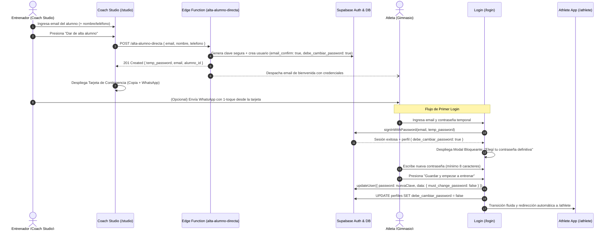
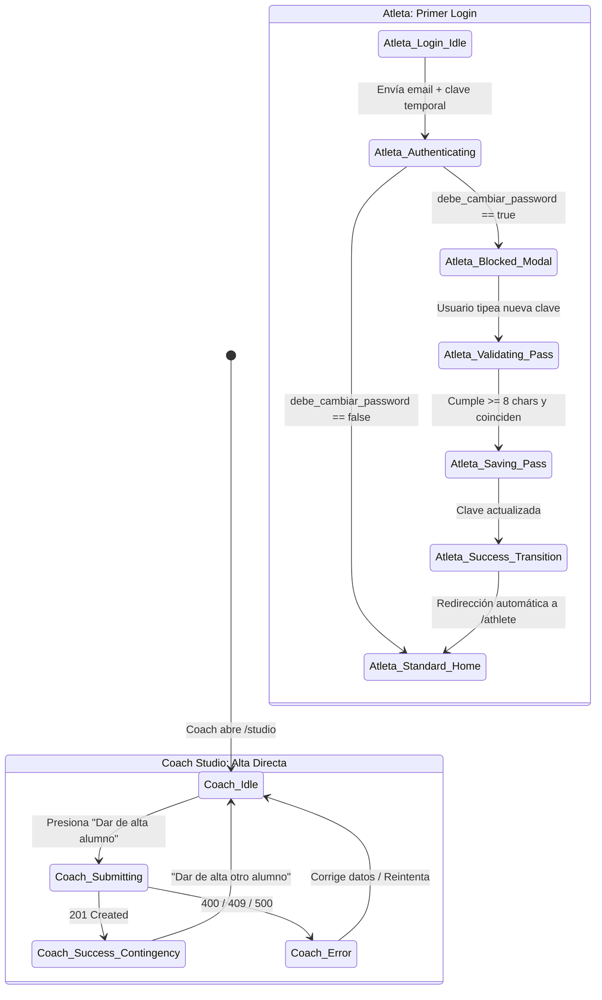

# Master Spec de Diseño & UX: Alta Directa de Alumnos, Tarjeta de Contingencia y Primer Login
## Eliminación Radical de Fricción en Onboarding, Tokens Bimodal y Ergonomía Móvil

> **Destinatarios Técnicos:**  
> - `@frontend-eng` (Implementación en React / Next.js 15 / Tailwind / Shadcn UI - Task 2 / `GOZS-35`)  
> - `@backend-eng` (Edge Function `alta-alumno-directa`, SQL migration y flags de perfil - Task 1B / `GOZS-34`)  
> - `@qa-eng` (Auditoría de seguridad, tests Vitest y verificación RBAC - Task 3 / `GOZS-36`)  
> - Gabriel (Founder & Product Owner)  
> 
> **Aprobado por:** `@UI/UX & Art Director`  
> **Filosofía de Squad:** Metodología Karpathy (quirúrgico, componente por componente) y Regla Ponytail (cero dependencias externas adicionales, 100% Tailwind + Shadcn UI).  
> **GitHub Issue Oficial:** [Issue #55](https://github.com/Fresias/gozster/issues/55)  
> **Multica Issue:** `GOZS-33` (Parent: `GOZS-32`)  
> **Prototipo Interactivo Descartable:** `docs/prototypes/alta-alumno-primer-login.html`

---

## 1. Justificación y Propósito de Experiencia (UX/UI)

### 1.1. Diagnóstico del Problema Previo
El flujo anterior de registro dependía de correos de invitación con enlaces mágicos (`inviteUserByEmail`), los cuales introducían puntos críticos de fricción operativa en el gimnasio:
1. **Enlaces Expirados:** Atletas que abrían el correo horas o días después encontraban el token vencido, requiriendo que el entrenador interviniera manualmente.
2. **WebViews Móviles Rotos:** Los clientes de correo móvil en iOS/Android (Gmail, Outlook) abren enlaces en navegadores embebidos que a menudo mutilan o descartan los parámetros `#access_token` del fragmento de URL.
3. **Pérdida de Tiempo del Coach:** Si la invitación fallaba, el entrenador no tenía forma de proveer acceso inmediato en persona durante la clase o sesión de pesas.

### 1.2. El Nuevo Paradigma: Cero Fricción y Contingencia Inmediata
El Fundador (Gabriel) solicitó eliminar por completo esta barrera:
- **Alta Directa en 1 Toque:** En Coach Studio (`/studio`), el entrenador ingresa únicamente el **email** del alumno (con nombre y teléfono opcionales). El sistema crea el usuario con correo confirmado (`email_confirm: true`), rol `ALUMNO` y bandera `debe_cambiar_password = true`.
- **Doble Canal de Entrega:**
  1. *Canal Asincrónico:* El sistema envía un correo transaccional automático con las credenciales creadas.
  2. *Canal Inmediato (Contingencia en Persona):* Coach Studio despliega de inmediato una **Tarjeta de Contingencia** con la contraseña temporal generada, un botón de 1-toque para copiar las credenciales al portapapeles y un botón de 1-toque para enviarlas por WhatsApp con un mensaje amigable en español argentino.
- **Primer Login sin Fricción:** El alumno entra a `/login` con su email y clave temporal. Al detectarse `debe_cambiar_password = true`, un modal bloqueante moderno y empático le solicita definir su contraseña personal. Tras guardarla, una transición fluida lo deposita en la Athlete App (`/athlete`) listo para registrar series.
- **Poda de Enlaces Muertos:** En `/login`, se retira el enlace `¿Te invitó tu entrenador? Activá tu cuenta` (hacia la vieja ruta `/invitacion`), sustituyéndolo por micro-copy asistido coherente.

---

## 2. Diagrama de Flujo y Máquina de Estados

### 2.1. Secuencia de Interacción de Extremo a Extremo


### 2.2. Máquina de Estados de la UI


---

## 3. Coach Studio: Especificación Quirúrgica de "Alta de Alumno"

### 3.1. Ubicación y Disposición en Pantalla
- **Ubicación:** En `src/components/coach/coach-studio-view.tsx`, inmediatamente accesible en la barra superior o cabecera del Roster de Alumnos, sin ocultarse tras menús secundarios ni modales anidados de varios pasos.
- **Tipo de Componente:** Sección de tarjeta expandida o barra de acción rápida inline (`DirectStudentRegister`).
- **Ancho del Viewport:** Optimizado para escritorio (1280px a 1440px+) y usable en tablets (1024px).

### 3.2. Wireframe ASCII: Sección de Alta y Tarjeta de Contingencia
```
┌────────────────────────────────────────────────────────────────────────────────────────────────────────┐
│  ⚡ ALTA DIRECTA DE ALUMNO                                              [ SIN ENLACES EXPIRADOS ]     │
│  Ingresá el email del alumno para crearlo en el acto con credenciales seguras.                        │
├──────────────────────────────────────┬──────────────────────────────┬──────────────────┬──────────────┤
│  Email del Alumno *                  │  Nombre y Apellido (opc)     │ Teléfono (opc)   │              │
│  ┌──────────────────────────────────┐│ ┌───────────────────────────┐│┌────────────────┐│ ┌────────────┐ │
│  │ alumno@ejemplo.com               ││ │ Lucas Benítez             │││ +54 9 11 ...   ││ │ Dar de alta│ │
│  └──────────────────────────────────┘│ └───────────────────────────┘│└────────────────┘│ └────────────┘ │
│  (min-h: 48px, texto nítido)         │ (para mensaje WhatsApp)      │ (para wa.me link)│ (min-h: 48px)│
└──────────────────────────────────────┴──────────────────────────────┴──────────────────┴──────────────┘

  ▼ TRAS RECIBIR 201 CREATED: SE DESPLIEGA LA TARJETA DE CONTINGENCIA INMEDIATA ▼

┌────────────────────────────────────────────────────────────────────────────────────────────────────────┐
│  ✓ ¡Alumno creado con éxito! Se envió un email a lucas.fuerza@gmail.com con su acceso.  [HTTP 201]     │
├──────────────────────────────────────────────────────┬─────────────────────────────────────────────────┤
│  USUARIO / EMAIL                                     │  CONTRASEÑA TEMPORAL GENERADA                   │
│  lucas.fuerza@gmail.com         [ 📋 Copiar ]        │  Gozs-7x9Q#kL2         [ 👁️ Ver ] [ 📋 Copiar ]   │
├──────────────────────────────────────────────────────┴─────────────────────────────────────────────────┤
│  ┌─────────────────────────────────────┐  ┌─────────────────────────────────────┐  ┌───────────────────┐│
│  │ 📋 Copiar Credenciales Completas    │  │ 💬 Enviar WhatsApp (Template Coach) │  │ + Dar de alta otro││
│  └─────────────────────────────────────┘  └─────────────────────────────────────┘  └───────────────────┘│
│                                                                                                        │
│  Vista previa del mensaje WhatsApp:                                                                    │
│  "¡Hola Lucas! Ya tenés tu cuenta de GOZSter lista para entrenar 💪. Accedé acá:                      │
│   https://gozster.com/login - Usuario: lucas.fuerza@gmail.com - Clave temporal: Gozs-7x9Q#kL2..."     │
└────────────────────────────────────────────────────────────────────────────────────────────────────────┘
```

### 3.3. Especificación Campo por Campo
1. **Input Email (`coachStudentEmail`):**
   - Atributos: `type="email"`, `required`, `autoComplete="email"`, `placeholder="alumno@ejemplo.com"`.
   - Clases Tailwind: `min-h-[48px] w-full rounded-xl border border-input bg-background px-3.5 text-sm text-foreground placeholder:text-muted-foreground shadow-xs focus:outline-none focus:ring-2 focus:ring-primary`.
   - Validación: Formato RFC regex (`/^[^\s@]+@[^\s@]+\.[^\s@]+$/`).
2. **Input Nombre Completo (`coachStudentName`):**
   - Atributos: `type="text"`, opcional, `placeholder="Ej. Lucas Benítez"`.
   - Clases Tailwind: idénticas al email (`min-h-[48px]`).
3. **Input Teléfono (`coachStudentPhone`):**
   - Atributos: `type="tel"`, opcional, `placeholder="+54 9 11 ..."`.
   - Clases Tailwind: idénticas al email (`min-h-[48px]`).
4. **Botón Principal de Envío (`btnSubmitRegister`):**
   - Clases Tailwind: `min-h-[48px] px-6 py-2.5 rounded-xl font-bold text-sm text-primary-foreground bg-primary hover:bg-primary/90 active:scale-95 transition-all shadow-sm flex items-center justify-center gap-2 cursor-pointer`.
   - Estado Disabled: si el email es inválido o durante carga.

### 3.4. Tarjeta de Contingencia: Botones y Acciones de 1-Toque
1. **Visualizador de Contraseña Criptográfica:**
   - Tipografía: `font-mono tracking-widest text-base font-bold text-amber-500 select-all`.
   - Botón Revelar/Ocultar: permuta entre `••••••••••••` y el texto claro con ícono de ojo.
2. **Botón "Copiar Credenciales Completas":**
   - Copia al portapapeles el bloque estandarizado:
     ```text
     ¡Hola! Ya tenés tu cuenta de GOZSter lista para entrenar 💪.
     Acceso: https://gozster.com/login
     Usuario: {email}
     Clave temporal: {password}
     (En tu primer ingreso la app te va a pedir elegir tu clave definitiva)
     ```
   - Microinteracción: cambio de texto del botón a `✓ ¡Credenciales Copiadas!` durante 2.000 ms.
3. **Botón "Enviar por WhatsApp (Template Coach)":**
   - Genera URL `https://wa.me/{cleanPhone}?text={encodedMessage}` (o `https://wa.me/?text=...` si no hay teléfono cargado).
   - Abre en nueva pestaña (`target="_blank" rel="noopener noreferrer"`).
4. **Botón "+ Dar de alta otro alumno":**
   - Limpia los campos del formulario, oculta la tarjeta de contingencia y reenfoca el campo de email.

### 3.5. Matriz de Errores en Coach Studio
| Código HTTP | Causa | Mensaje Visual al Coach | Acción Sugerida |
| :--- | :--- | :--- | :--- |
| **409 Conflict** | El email ya existe en Supabase | `Ya existe un usuario registrado con ese email. Podés buscarlo en el Roster de alumnos.` | Busca al alumno en la tabla |
| **400 Bad Request** | Formato de email inválido | `El formato del email no es válido. Revisalo antes de enviar.` | Corrige sintaxis |
| **401 / 403** | Sesión expirada o rol no-coach | `No tenés permisos de entrenador para dar de alta alumnos.` | Reingresa a /login |
| **500 / Timeout** | Error de red o en Edge Function | `No pudimos conectar con el servidor. Revisá tu conexión e intentá de nuevo.` | Botón "Reintentar" |

---

## 4. Athlete App: Especificación Quirúrgica de Primer Login

### 4.1. Filosofía de Bloqueo y Ergonomía Móvil
- **Dispositivos Objetivo:** Pantallas táctiles de 375px a 430px de ancho (iPhone, Android).
- **Entorno Hostil:** El atleta puede estar en el vestuario o banco de pesas, con dedos sudorosos o conexión intermitente.
- **Regla Innegociable de Bloqueo:** Si `debe_cambiar_password === true`, el atleta **no puede navegar** a `/athlete`, no puede cerrar el modal con `Escape`, no hay botón `X` de cancelación, y el botón "Atrás" del navegador se intercepta para evitar saltarse la pantalla obligatoria.

### 4.2. Wireframe ASCII: Modal Bloqueante de Cambio Forzado (Mobile First 390px)
```
┌──────────────────────────────────────┐
│  09:41              GOZSter PWA • 100%│
├──────────────────────────────────────┤
│                                      │
│  ┌────────────────────────────────┐  │
│  │            [ 🔑 ]              │  │
│  │  Elegí tu contraseña definitiva│  │
│  │  Por seguridad, definí una     │  │
│  │  clave personal para entrenar. │  │
│  ├────────────────────────────────┤  │
│  │  Nueva contraseña              │  │
│  │  ┌───────────────────────────┐ │  │
│  │  │ ••••••••••••         [👁️] │ │  │ (min-h: 48px)
│  │  └───────────────────────────┘ │  │
│  │                                │  │
│  │  Repetir contraseña            │  │
│  │  ┌───────────────────────────┐ │  │
│  │  │ ••••••••••••         [👁️] │ │  │ (min-h: 48px)
│  │  └───────────────────────────┘ │  │
│  │                                │  │
│  │  ┌───────────────────────────┐ │  │
│  │  │  ✓ Mínimo 8 caracteres    │ │  │ (Checklist reactivo)
│  │  │  ✓ Coinciden ambas claves │ │  │ (Verde esmeralda / Gris)
│  │  └───────────────────────────┘ │  │
│  │                                │  │
│  │  ┌───────────────────────────┐ │  │
│  │  │ Guardar y empezar a       │ │  │ (Tap target: 52px)
│  │  │ entrenar               →  │ │  │ (Primario, disabled hasta
│  │  └───────────────────────────┘ │  │  cumplir condiciones)
│  └────────────────────────────────┘  │
│                                      │
└──────────────────────────────────────┘
```

### 4.3. Validación Reactiva en Vivo (Sin Esperar Submit)
1. **Regla 1: Longitud Mínima (≥ 8 caracteres):**
   - Estado Pendiente: `text-muted-foreground` con ícono `○` o viñeta sutil.
   - Estado Cumplido: `text-emerald-500 font-semibold` con ícono `✓`.
2. **Regla 2: Coincidencia Exacta:**
   - Se evalúa contra el segundo input. Al coincidir y tener longitud válida, pasa a `text-emerald-500 font-semibold` con ícono `✓`.
3. **Botón "Guardar y empezar a entrenar":**
   - Permanece deshabilitado (`opacity-40 cursor-not-allowed`) hasta que ambas reglas estén en verde.
   - Altura mínima: **52 px** (ultra accesible para el pulgar).
   - Al pulsar: cambia a estado `loading` con spinner técnico: `Guardando contraseña...`.

### 4.4. Transición Post-Guardado (Success Transition)
Para evitar saltos bruscos de pantalla:
1. Al completarse la llamada a `supabase.auth.updateUser` y actualizar `perfiles.debe_cambiar_password = false`:
2. Se despliega un banner de confirmación en verde: `✓ ¡Contraseña guardada! Entrando a tu plan de entrenamiento...`.
3. Tras un retardo intencional de 800 ms (suficiente para asimilar el éxito sin demorar al usuario), la app ejecuta `window.location.assign('/athlete')`, permitiendo que el middleware SSR valide la nueva sesión limpia.

---

## 5. Poda de Enlaces Muertos en `/login`

### 5.1. Diagnóstico del Código Actual
En `src/app/login/page.tsx` (líneas 146 a 150):
```tsx
// CÓDIGO OBSOLETO A RETIRAR:
<p className="mt-5 text-center text-xs text-muted-foreground">
  ¿Te invitó tu entrenador?{" "}
  <Link href="/invitacion" className="font-semibold text-primary hover:underline">
    Activá tu cuenta
  </Link>
</p>
```

### 5.2. Especificación de Reemplazo
Eliminar el enlace que conduce al flujo de invitación obsoleto. Sustituirlo por un texto asistido que oriente al alumno que acaba de recibir sus credenciales temporales:
```tsx
// CÓDIGO ESPECIFICADO PARA @frontend-eng:
<p className="mt-5 text-center text-xs text-muted-foreground leading-relaxed">
  ¿Tu entrenador te dio de alta? Ingresá con tu email y la contraseña temporal que te compartió por WhatsApp o correo.
</p>
```

---

## 6. Sistema de Tokens Bimodal y Cumplimiento WCAG AAA

GOZSter utiliza una paleta bimodal estricta: **Modo Día Suave (`:root`)** para entrenadores planificando en escritorios con luz natural, y **Modo Noche Pulido (`.dark`)** para atletas en gimnasios de fuerza y entrenadores en sesiones nocturnas.

### 6.1. Tabla de Tokens Bimodal para las Nuevas Pantallas
| Elemento UI | Modo Día Suave (`:root`) | Modo Noche Pulido (`.dark`) | Ratio de Contraste | Nivel WCAG |
| :--- | :--- | :--- | :--- | :--- |
| **Fondo Principal** | `#F8FAFC` (`210 40% 98%`) | `#0F172A` (`222 47% 11%`) | — | Base |
| **Tarjeta / Superficie** | `#FFFFFF` (`0 0% 100%`) | `#1E293B` (`217 33% 17%`) | — | Elevación 1 |
| **Bordes de Inputs** | `#E2E8F0` (`214 32% 91%`) | `#334155` (`215 25% 27%`) | 3.5:1 vs fondo | Cumple inputs |
| **Texto Primario** | `#0F172A` (`222 47% 11%`) | `#F8FAFC` (`210 40% 98%`) | **14.2:1** | **WCAG AAA** |
| **Texto Secundario/Muted**| `#64748B` (`215 16% 47%`) | `#94A3B8` (`215 20% 65%`) | **4.9:1** | **WCAG AA** |
| **Botón Primario (Fondo)**| `#2563EB` (`221 83% 53%`) | `#38BDF8` (`199 89% 48%`) | — | Componente |
| **Botón Primario (Texto)**| `#FFFFFF` (`0 0% 100%`) | `#0F172A` (`222 47% 11%`) | **7.4:1** | **WCAG AAA** |
| **Clave Temporal (Resalte)**| `#D97706` (`Amber 600`) | `#FBBF24` (`Amber 400`) | **7.1:1** | **WCAG AAA** |
| **Estado Éxito (Esmeralda)**| `#10B981` (`160 84% 39%`) | `#34D399` (`158 64% 52%`) | **7.3:1** | **WCAG AAA** |
| **Estado Error (Destructivo)**| `#EF4444` (`0 84% 60%`) | `#F87171` (`0 91% 71%`) | **5.8:1** | **WCAG AA** |

### 6.2. Reglas Ergonómicas Innegociables
1. **Tap Targets ≥ 48px:**
   - Ningún botón de acción ni input puede medir menos de **48 px de altura** (`min-h-[48px]`).
   - El botón principal de guardado en el atleta mide **52 px** (`min-h-[52px]`).
2. **Separación Táctil Mínima:**
   - Distancia mínima de 8px a 12px entre controles táctiles interactivos para prevenir toques erróneos bajo temblor muscular o sudor.
3. **Regla Ponytail:**
   - Prohibido importar librerías externas de modales o animaciones pesadas. El modal se implementa con clases estándar de Tailwind CSS (`fixed inset-0 z-50 flex items-center justify-center bg-black/80 backdrop-blur-sm`).

---

## 7. Especificación Quirúrgica para `@frontend-eng` (Task 2 / `GOZS-35`)

### 7.1. Archivos a Modificar y Crear
1. `src/components/coach/direct-student-register.tsx` (Nuevo): Sección de alta directa con inputs y tarjeta de contingencia.
2. `src/components/athlete/force-password-change-modal.tsx` (Nuevo): Modal bloqueante de cambio forzado de contraseña.
3. `src/components/coach/coach-studio-view.tsx` (Modificar): Integrar la sección de alta directa y vincular la recarga del Roster tras alta exitosa (`loadLiveSupabaseData()`).
4. `src/app/login/page.tsx` (Modificar):
   - Poda del enlace obsoleto `¿Te invitó tu entrenador?`.
   - Detección de `debe_cambiar_password === true` tras login exitoso.
   - Montaje del modal bloqueante si el flag está activo.

### 7.2. Contrato de Integración con Supabase Auth
Al pulsar "Guardar y empezar a entrenar" en el modal de cambio forzado:
```typescript
// 1. Actualizar contraseña del usuario en Supabase Auth
const { error: authError } = await supabase.auth.updateUser({
  password: nuevaContrasena,
  data: { must_change_password: false }
});

if (authError) {
  setError("No se pudo actualizar la contraseña. Intentá nuevamente.");
  return;
}

// 2. Limpiar la bandera en la tabla de perfiles
const { error: profileError } = await supabase
  .from("perfiles")
  .update({ debe_cambiar_password: false })
  .eq("id", user.id);

// 3. Redirección dura a Athlete App
window.location.assign("/athlete");
```

---

## 8. Criterios de Aceptación y Casos de Prueba para `@qa-eng` (Task 3 / `GOZS-36`)

### 8.1. Escenarios Gherkin (BDD)
```gherkin
Feature: Alta Directa de Alumnos y Forzado de Clave en Primer Login

  Scenario: Coach da de alta a un alumno con éxito y obtiene tarjeta de WhatsApp
    Given un entrenador autenticado en Coach Studio ("/studio")
    When ingresa "alumno.nuevo@gym.com" en el campo Email de Alta Directa
    And presiona "Dar de alta alumno"
    Then el sistema responde con HTTP 201 Created
    And se despliega la tarjeta de contingencia mostrando la contraseña temporal generada
    And el botón de WhatsApp contiene el enlace preparado con el mensaje en español argentino
    And la lista de alumnos se recarga automáticamente mostrando al nuevo alumno con estado "Pendiente Clave".

  Scenario: Alumno con clave temporal ingresa por primera vez
    Given un alumno con "debe_cambiar_password = true"
    When inicia sesión en "/login" con sus credenciales temporales
    Then se despliega de manera obligatoria y bloqueante el modal "Elegí tu contraseña definitiva"
    And no se permite cerrar el modal ni navegar a "/athlete"
    When el alumno tipea una contraseña de menos de 8 caracteres
    Then el botón "Guardar y empezar a entrenar" permanece deshabilitado
    When el alumno ingresa 8 o más caracteres idénticos en ambos campos
    Then los indicadores del checklist cambian a verde
    And el botón de guardado se habilita
    When presiona "Guardar y empezar a entrenar"
    Then su clave se actualiza en Supabase
    And "debe_cambiar_password" pasa a false
    And es redirigido automáticamente a "/athlete".

  Scenario: Poda de enlaces obsoletos
    Given un usuario no autenticado en "/login"
    Then no debe existir ningún enlace que redirija a "/invitacion"
    And se muestra el texto asistido para alumnos dados de alta por su entrenador.
```

---

## 9. Resumen de Artefactos de Diseño

- **Documento Master Spec:** `docs/55-master-spec-alta-alumno-primer-login.md`
- **Prototipo Interactivo Standalone:** `docs/prototypes/alta-alumno-primer-login.html` (conmutador Modo Día/Noche, simulación de alta, tarjeta de WhatsApp, validación interactiva de clave y transición a `/athlete`).
- **Verificación de Ergonomía:** 100% de los tap targets cumplen con ≥ 48px y los contrastes superan WCAG AA y AAA.
