# Master Spec & Orden de Implementación — GOZS (Post `/grill-with-docs`)

> **Documento Maestro de Gobernanza para el Squad (`@backend-eng`, `@frontend-eng`, `@UI/UX & Art Director`, `@qa-eng`)**
> **Referencias obligatorias:** `docs/GLOSSARY.md`, `ADR-001`, `ADR-002`, `ADR-003`, `ADR-004`, `ADR-005`.

---

## 1. Resumen Ejecutivo de Decisiones Cerradas en el Grill

1. **Cero rastro de "Mynter" en UI (`ADR-005`):** Se eliminan todas las menciones a "Mynter" en `src/app/page.tsx:38`, `src/components/athlete/live-workout.tsx:247`, `src/components/coach/studio-shell.tsx:148` y `src/services/alumnos-service.ts`.
2. **Separación de Estados y Vencimientos con Fecha Anclada (`ADR-001`):**
   - Entidades separadas: `perfiles` (estado de cuenta), `contrataciones` (tipo `ASESORIA_ONLINE` / `PRESENCIAL`, estados `VIGENTE`, `POR_VENCER` a -5 días, `VENCIDA` a +1 día, `EN_PAUSA`, `PENDIENTE_RENOVACION`), `pagos` (con `idempotency_key` UNIQUE para evitar doble cobro/período) y `planes_entrenamiento` (estado de rutina).
   - **Regla "No se corre la fecha":** Si venció el día 10 y paga el 18, el nuevo vencimiento se mantiene el día **10 del mes siguiente**.
   - **Alumno vencido con acceso + aviso al inicio:** Se reemplaza el bloqueo total (`<MembershipPaywall />`) por un aviso claro al iniciar la app indicando que la suscripción venció y que hable con el equipo de GOZS (manteniendo acceso a la app y al Chat GOZS habilitado).
3. **Onboarding No Bloqueante y Vista Minimalista vs. Técnica (`ADR-004`):**
   - Acceso inmediato a la app + **solapa opcional de Cuestionario Inicial** (única vez, con preguntas genéricas para la demo).
   - Flag `nivel_vista_alumno` (`SIMPLE` minimalista por defecto: Series × Reps × Peso + Video + Descanso; `TECNICA` con RPE, %1RM y métricas avanzadas).
4. **Chat Compartido 100% Equipo GOZS (`ADR-004`):**
   - Frente al alumno solo figura **"GOZS"** ("Somos un equipo", sin firmas individuales).
   - En base de datos y en el Coach Studio se registra el `remitente_id` real, quién modificó la rutina (`auditoria_cambios`) y el `responsable_id` de la conversación. Transferir una conversación vincula automáticamente al profesor en `entrenador_alumnos` para cumplir RLS.
5. **Reporte de Molestias, Red Flags y Sustitución Exclusiva del Entrenador (`ADR-002`):**
   - Botón visible **"Tengo una molestia"** en sesión y en ejercicio (zona, intensidad, momento de aparición, ejercicio y checks de alarma).
   - **Síntomas de alarma (Red Flags):** Disparan alerta `CRITICA` y recomiendan al alumno **frenar por hoy y avisar en el gimnasio o al entrenador cercano**.
   - **El alumno NO elige el ejercicio alternativo.** El entrenador lo asigna desde el Coach Studio para **toda la rutina vigente** usando la Biblioteca de Alternativas, guardando trazabilidad en `public.sustituciones_ejercicios` (`ejercicio_original_id`, `ejercicio_sustituto_id`, `fecha`, `motivo`, `responsable_id`) sin alterar sesiones ya completadas.
6. **Fases 5 (Presencial: Funcional y Boxeo) y 6 (Gamificación: Rachas y PRs) (`ADR-003`):**
   - Diferidas con alcance mínimo para el **Próximo Sprint (Sprint 2)**.

---

## 2. Orden de Implementación y Desglose de Specs por Agente (Sprint Actual: Fases 1 a 4)

El trabajo se estructura en **4 Bloques Secuenciales (Épicas)** donde cada bloque respeta el flujo:
`Stage 1 (@UI/UX & Art Director / @backend-eng)` → `Stage 2 (@frontend-eng)` → `Stage 3 (@qa-eng)` → `Merge por @PM-GOZster`.

```mermaid
flowchart TD
    subgraph F1["Fase 1 (P0): Fundamentos, Estados, Pagos, Limpieza Mynter y Backup"]
        B1["Stage 1 · @backend-eng: Migración contrataciones, pagos idempotentes, auditoria_cambios y script backup/restore"]
        F1_UI["Stage 2 · @frontend-eng: Purga total de 'Mynter', banner de vencimiento al inicio sin bloquear app y gestión de pagos/extensiones"]
        Q1["Stage 3 · @qa-eng: Tests de idempotencia de renovación, anclaje día 10->10, RLS y prueba de restauración de backup"]
        B1 --> F1_UI --> Q1
    end

    subgraph F2["Fase 2 (P1): Onboarding Opcional y Vista Minimalista vs. Técnica"]
        U2["Stage 1 · @UI/UX & Art Director + @backend-eng: Spec UI Minimalista + tabla cuestionario_inicial y flag nivel_vista_alumno"]
        F2_UI["Stage 2 · @frontend-eng: Solapa Cuestionario Inicial (no bloqueante) y modo SIMPLE vs TECNICA en LiveWorkout y Coach Studio"]
        Q2["Stage 3 · @qa-eng: Tests E2E/unitarios de alta sin bloqueo y ocultamiento de RPE/1RM en vista SIMPLE"]
        U2 --> F2_UI --> Q2
    end

    subgraph F3["Fase 3 (P1): Chat Compartido Equipo GOZS y Auditoría"]
        B3["Stage 1 · @backend-eng: RPC transferir_conversacion (con alta automática en entrenador_alumnos) y auditoría de rutinas"]
        F3_UI["Stage 2 · @frontend-eng: Conexión real de use-chat-store a Supabase, identidad única 'GOZS' al alumno y transferencia en Studio"]
        Q3["Stage 3 · @qa-eng: Tests de continuidad por 2do profesor, autoría real interna e identidad institucional hacia el alumno"]
        B3 --> F3_UI --> Q3
    end

    subgraph F4["Fase 4 (P1): Molestias, Síntomas de Alarma y Sustitución por Entrenador"]
        B4["Stage 1 · @backend-eng: Tabla sustituciones_ejercicios, biblioteca alternativas, Red Flags e inmutabilidad de quick_swap_ejercicio"]
        F4_UI["Stage 2 · @frontend-eng: Botón 'Tengo una molestia' con pantalla de freno por Red Flag; selector de sustitución exclusivo del Coach"]
        Q4["Stage 3 · @qa-eng: Tests de trazabilidad original->sustituto, inmutabilidad de sesiones cerradas y disparo de alerta CRITICA"]
        B4 --> F4_UI --> Q4
    end

    Q1 --> U2
    Q2 --> B3
    Q3 --> B4
```

---

### Detalle de Entregables por Fase (Sprint Actual)

#### 🧱 FASE 1 (P0 · Crítico): Modelo de Contrataciones, Pagos Idempotentes, Purga de "Mynter" y Backup
- **`@backend-eng` (Stage 1):**
  - Nueva migración append-only en `supabase/migrations/`:
    - Tabla `public.contrataciones` (`id`, `alumno_id`, `tipo_servicio` [`ASESORIA_ONLINE`, `PRESENCIAL`], `estado` [`VIGENTE`, `POR_VENCER`, `VENCIDA`, `EN_PAUSA`, `PENDIENTE_RENOVACION`], `dia_anclaje`, `fecha_inicio`, `fecha_fin`).
    - Función/vista de actualización automática de estado: `POR_VENCER` (5 días antes de `fecha_fin`), `VENCIDA` (1 día después de `fecha_fin`).
    - Tabla `public.pagos` (`id`, `contratacion_id`, `monto`, `medio_pago`, `estado`, `idempotency_key` UNIQUE, `confirmado_por`, `confirmado_at`).
    - RPC `registrar_renovacion_pago`: verifica `idempotency_key` y extiende `fecha_fin` respetando el **anclaje de fecha original** (si vencía el 10 y paga el 18, vence el 10 del mes siguiente).
    - Tabla `public.auditoria_cambios` y RPC `extender_vigencia_excepcional` (exige `motivo` y guarda `autorizado_por`).
    - Script `scripts/backup-restore-gozs.mjs` para exportar y verificar restauración íntegra.
- **`@frontend-eng` (Stage 2):**
  - Eliminar toda mención a "Mynter" en `src/app/page.tsx:38`, `src/components/athlete/live-workout.tsx:247`, `src/components/coach/studio-shell.tsx:148` y `src/services/alumnos-service.ts`.
  - En `src/app/(athlete)/athlete/page.tsx`: quitar el bloqueo completo de `<MembershipPaywall />` y reemplazarlo por un modal/banner de inicio cuando la contratación está `VENCIDA` (*"Tu suscripción venció. Hablá con el equipo de GOZS"* con botón directo para abrir `<AthleteChat />`), permitiendo usar la app.
  - En Coach Studio: modal de confirmación de pago manual y extensión excepcional con motivo obligatorio.
- **`@qa-eng` (Stage 3):**
  - Suite Vitest comprobando: (1) doble intento de renovación con igual `idempotency_key` no duplica período ni cobro; (2) pago el día 18 sobre vencimiento del día 10 fija próximo vencimiento el día 10; (3) baja administrativa no borra historial; (4) cero ocurrencias de la palabra `"Mynter"` en componentes UI; (5) test de backup + restauración.

#### 🚀 FASE 2 (P1 · Alta): Alta Inmediata, Solapa de Cuestionario Opcional y Vista Minimalista (`SIMPLE` vs. `TECNICA`)
- **`@UI/UX & Art Director` + `@backend-eng` (Stage 1):**
  - Migración con columna `perfiles.nivel_vista_alumno` (`'SIMPLE' | 'TECNICA'`, default `'SIMPLE'`) y tabla `public.alumno_cuestionario_inicial` (`alumno_id`, `respuestas_json`, `completado_at`).
  - Spec visual corto de la solapa "Mi Ficha / Cuestionario" y del modo minimalista de `LiveWorkout`.
- **`@frontend-eng` (Stage 2):**
  - Agregar en Athlete App la solapa **Cuestionario Inicial** (por única vez, opcional, no bloquea el entrenamiento) con preguntas genéricas de demo.
  - Adaptar `src/components/athlete/live-workout.tsx` para que cuando `nivel_vista_alumno === 'SIMPLE'` solo renderice **Series × Reps × Peso + Video + Descanso** (ocultando RPE, %1RM, calculadora de discos avanzada y métricas de tonelaje), y agregar el toggle `Vista Alumno: Simple / Técnica` en la ficha del alumno dentro del Coach Studio.
- **`@qa-eng` (Stage 3):**
  - Tests verificando que un alumno recién dado de alta llega a su primera rutina sin bloqueos y que el flag `SIMPLE` oculta toda métrica técnica compleja.

#### 💬 FASE 3 (P1 · Alta): Chat Compartido con Identidad 100% Equipo GOZS y Transferencia de Responsable
- **`@backend-eng` (Stage 1):**
  - Migración agregando `responsable_id` y `estado_conversacion` a `public.conversaciones`.
  - RPC `transferir_conversacion_gozs(p_conversacion_id, p_nuevo_responsable_id)`: actualiza el responsable, registra el evento en `public.auditoria_cambios` y asegura el vínculo en `public.entrenador_alumnos` para que RLS habilite acceso inmediato al nuevo profesor.
- **`@frontend-eng` (Stage 2):**
  - Conectar `src/store/use-chat-store.ts` a las tablas reales `public.conversaciones` y `public.mensajes` (con fallback offline seguro).
  - En `<AthleteChat />`: todos los mensajes del staff se muestran siempre como **"Equipo GOZS"** (sin mostrar el nombre individual del profesor al alumno).
  - En Coach Studio: mostrar qué profesor fue el autor real (`remitente_id`) en cada burbuja y añadir selector para asignar/transferir responsable de la conversación.
- **`@qa-eng` (Stage 3):**
  - Tests verificando que un segundo profesor transferido accede al historial completo, que el alumno solo ve la identidad "GOZS" y que en BD/Studio queda registrada la autoría real de cada mensaje.

#### 🩺 FASE 4 (P1 · Alta): Reporte de Molestias, Síntomas de Alarma y Sustitución Trazable por Entrenador
- **`@backend-eng` (Stage 1):**
  - Migración:
    - Ampliar `public.alumno_historial_dolor` con `momento_aparicion`, `es_sintoma_alarma` (boolean) y estado del caso (`PENDIENTE`, `ATENDIDO`, `CERRADO`).
    - Crear tabla `public.ejercicios_alternativas` (clasificada por patrón, equipamiento, exigencia, restricciones y explicación técnica).
    - Crear tabla `public.sustituciones_ejercicios` (`id`, `plan_id`, `ejercicio_en_rutina_id`, `ejercicio_original_id`, `ejercicio_sustituto_id`, `reporte_dolor_id`, `motivo`, `responsable_id`, `created_at`).
    - Actualizar `public.quick_swap_ejercicio` para que inserte en `public.sustituciones_ejercicios`, mantenga inmutables las `registro_sesiones` completadas y marque el reporte como `ATENDIDO`.
- **`@frontend-eng` (Stage 2):**
  - En `<PainReportModal />` y `<LiveWorkout />`: botón visible **"Tengo una molestia"** en sesión y en cada ejercicio; incluir checks de síntomas de alarma.
  - Si marca síntoma de alarma o dolor agudo: mostrar pantalla de seguridad recomendando **frenar por hoy y avisar en el gimnasio o al entrenador cercano**, disparando alerta `CRITICA`. **El alumno no tiene selector para cambiar el ejercicio.**
  - En Coach Studio (`<QuickSwapModal />`): mostrar biblioteca de alternativas con explicación biomecánica y advertencia de no asumir seguridad clínica automática; al confirmar con un toque, aplica el reemplazo para toda la rutina vigente dejando trazabilidad visible del ejercicio original y sustituto.
- **`@qa-eng` (Stage 3):**
  - Tests verificando: (1) el alumno no puede ejecutar `quick_swap_ejercicio` por RLS; (2) el reemplazo del entrenador conserva el registro del ejercicio original en `sustituciones_ejercicios` y no altera sesiones pasadas; (3) los síntomas de alarma generan alerta `CRITICA` y muestran la recomendación de frenar.
