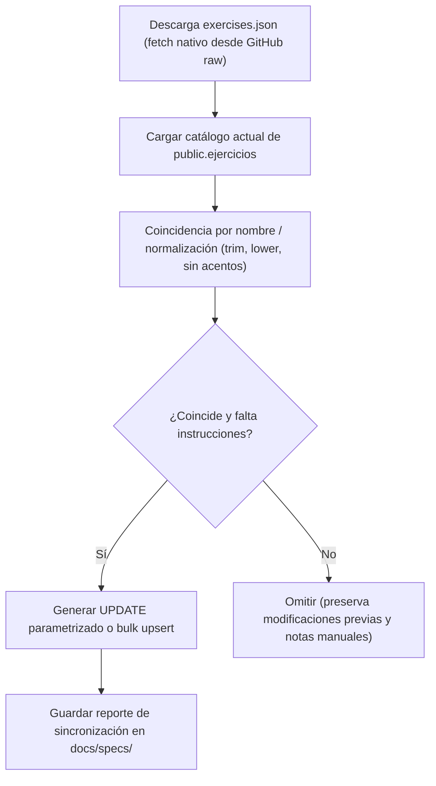

# Especificación Técnica: Fuente Abierta de Notas e Instrucciones para Ejercicios (GOZS-235)

> **Autor:** `@A-backend-eng` (Backend & Database Engineer)  
> **Reporta a:** `@A-PM-GOZster`  
> **Relacionado:** GOZS-280 (FE App: botón de notas del ejercicio junto a técnica y reporte)  
> **Principios:** Karpathy (diff quirúrgico y minimalismo), Ponytail (cero dependencias externas innecesarias), Supabase Postgres 15+ append-only y RLS estricto.

---

## 1. Contexto y Objetivos

En GOZSter, los ejercicios del catálogo general deben contar con notas e instrucciones técnicas estándar de ejecución (técnica, postura, consejos de respiración y seguridad). 

Actualmente:
- La tabla `public.ejercicios` posee una columna `comentario TEXT` que se usa de forma heterogénea o se encuentra vacía para la mayoría de los ejercicios importados.
- En la interfaz del atleta (App), la issue **GOZS-280** incorpora un botón de notas que abre el contenido técnico cuando el ejercicio dispone de `comentario` (biblioteca) o la rutina cuenta con `notas` (personalizadas por el coach).
- Se requiere seleccionar una fuente abierta de datos confiable, con licencia compatible y sin costos de API ni dependencias de servicios externos propietarios, proponiendo el modelo relacional aditivo y el plan de carga idempotente.

---

## 2. Comparativa de Fuentes Candidatas

Se evaluaron cuatro fuentes abiertas de referencia en la industria del fitness y el software libre:

| Criterio | `free-exercise-db` (yuhonas) | `wger` (Workout Manager) | `ExerciseDB` (AscendAPI) | `open-exercisedb` (Glowupp) |
| :--- | :--- | :--- | :--- | :--- |
| **Licencia** | **The Unlicense** (Dominio Público) | AGPL-3.0 (código) / **CC-BY-SA 4.0** (datos) | AGPL-3.0 / Propietaria comercial | **MIT** |
| **Volumen** | ~800+ ejercicios de fuerza y funcionales | ~1.000+ ejercicios comunitarios | ~1.300 ejercicios | ~800 ejercicios |
| **Estructura de Notas** | `instructions: string[]` (pasos secuenciales limpios) | `description: string` (HTML crudo `<p>`) | `instructions: string[]` | `instructions: string[]` |
| **Idioma** | Inglés | Multilingüe (incluye Español `id: 19`) | Inglés | Inglés |
| **Formato / Acceso** | JSON estático (`exercises.json`), raw GitHub | API REST con autenticación y rate limits | RapidAPI / SaaS pago | JSON estático en GitHub |
| **Calidad de Contenido** | Alta, uniforme, paso a paso | Dispar (traducciones comunitarias incompletas) | Alta | Buena |
| **Costo / Dependencia** | **$0**, sin API externa ni token | **$0**, requiere consumo de API o volcado | Freemium estricto / Pago mensual | **$0**, sin API |
| **Riesgo Legal / Copyleft** | **Nulo** (Dominio público total) | **Alto** (CC-BY-SA exige ShareAlike y atribución) | **Alto** (AGPL / Términos de API) | **Nulo** (Permisiva) |

### 2.1. Análisis Crítico de Licencias

1. **`free-exercise-db` (The Unlicense):**
   - Es una renuncia explícita de derechos de autor al dominio público mundial.
   - Permite el uso comercial, modificación, distribución e integración en bases de datos propietarias sin obligación de abrir el código derivado ni exigir cláusulas de atribución forzosa en la UI del producto.
2. **`wger` (CC-BY-SA 4.0 / 3.0):**
   - La cláusula **ShareAlike (CompartirIgual)** impone un riesgo significativo: cualquier base de datos modificada o enriquecida que se considere obra derivada debe redistribuirse bajo la misma licencia libre.
   - Además, la calidad de los textos en español en `wger` es altamente irregular (muchos registros solo contienen 1 oración o etiquetas HTML inconsistentes).
3. **`ExerciseDB`:**
   - Su repositorio oficial opera bajo AGPL-3.0 y su distribución mediante RapidAPI impone límites de peticiones mensuales y eventual suscripción paga, violando el principio Ponytail.

---

## 3. Recomendación Definitiva

Se recomienda **adoptar `free-exercise-db` (`yuhonas/free-exercise-db`)** como la fuente canónica de notas e instrucciones técnicas para GOZSter.

**Justificación:**
1. **Seguridad Jurídica:** Licencia *The Unlicense* sin restricciones comerciales ni contaminación de licencias derivadas (ShareAlike).
2. **Calidad de Datos:** Instrucciones estructuradas como lista ordenada de pasos (`instructions: string[]`), facilitando su renderizado limpio tanto en viñetas en la App móvil como en formato textual.
3. **Alineación con la Filosofía Ponytail:** No requiere dependencias de npm, SDKs de terceros ni tokens de API. Se procesa a partir de un archivo JSON descargable o consultable vía `fetch` nativo de Node.js en tiempo de build o mediante script one-shot.

---

## 4. Mapeo y Diseño de Datos (Supabase / PostgreSQL)

### 4.1. Separación de Responsabilidades
- **Notas de la Biblioteca (`ejercicios.instrucciones` / `ejercicios.comentario`):** Instrucciones técnicas universales del ejercicio (técnica, postura, precauciones generales).
- **Notas del Entrenador (`ejercicios_en_rutina.notas`):** Indicaciones específicas del coach para ese alumno en ese día particular (p. ej. *"pausa de 2 seg abajo"*, *"cuidar hombro derecho"*).

### 4.2. Mapeo de Campos de `free-exercise-db` a `public.ejercicios`

| Campo en `free-exercise-db` | Tipo Origen | Campo en `public.ejercicios` | Tipo Destino | Estrategia de Transformación |
| :--- | :--- | :--- | :--- | :--- |
| `name` | `string` | `nombre` | `TEXT` | Coincidencia de catálogo (matching directo o por alias normalizado). |
| `instructions` | `string[]` | `instrucciones` | `TEXT[]` | **Nueva columna aditiva** en `public.ejercicios` (`TEXT[] NOT NULL DEFAULT '{}'`). |
| `instructions` | `string[]` | `comentario` | `TEXT` | Concatenación de pasos con saltos de línea (`\n\n`) únicamente si `comentario IS NULL`, para mantener compatibilidad inmediata con vistas existentes. |
| `category` | `string` | - | - | Metadata de referencia para filtrado. |
| `primaryMuscles` | `string[]` | `musculos_principales` | `TEXT[]` | Enriquecimiento opcional donde esté vacío. |
| `secondaryMuscles`| `string[]` | `musculos_secundarios` | `TEXT[]` | Enriquecimiento opcional donde esté vacío. |

### 4.3. DDL Aditivo Propuesto (Append-Only)

Para persistir las instrucciones estructuradas en el esquema sin romper nada existente:

```sql
-- Migración aditiva sugerida:
ALTER TABLE public.ejercicios 
  ADD COLUMN IF NOT EXISTS instrucciones TEXT[] NOT NULL DEFAULT '{}';

COMMENT ON COLUMN public.ejercicios.instrucciones IS 'Pasos e instrucciones técnicas de ejecución provenientes de la biblioteca de ejercicios (free-exercise-db)';
```

Esta modificación:
- Es 100% aditiva y segura para producción.
- No altera las políticas RLS existentes (la lectura pública/autenticada y la restricción de escritura al rol admin/service-role se mantienen intactas).
- No bloquea lecturas y no requiere reconstrucción de tablas.

---

## 5. Plan de Carga Idempotente (Zero New Dependencies)

El proceso de carga se ejecutará mediante un script TypeScript/Node.js nativo (`scripts/seed_exercise_notes.ts`) sin librerías externas adicionales.

### 5.1. Flujo de Ejecución del Script de Carga


### 5.2. Reglas de Idempotencia
1. **No sobreescritura destructiva:** Si un ejercicio ya cuenta con `instrucciones` cargadas o un `comentario` personalizado redactado por los coaches de GOZSter, el script **no lo reemplaza** salvo flag explícito `--force`.
2. **Ejecución repetible:** Se puede ejecutar múltiples veces sin generar duplicados ni errores de constraint.
3. **Cero dependencias npm:** Se utiliza la API global `fetch` disponible de forma nativa en Node.js 18+ y el cliente ya instalado `@supabase/supabase-js`.

---

## 6. Respuestas a Decisiones de Negocio (para `@A-PM-GOZster`)

1. **¿Se acepta la licencia CC-BY-SA de `wger`?**  
   **Recomendación: NO.** La cláusula *ShareAlike* impone riesgos de contaminación copyleft sobre los datos derivados de la plataforma y exige mecanismos de atribución explícita en la UI del producto. `free-exercise-db` (The Unlicense) otorga la misma riqueza técnica sin condicionamientos legales.
   
2. **¿Son aceptables las instrucciones en inglés para la primera entrega?**  
   **Recomendación: SÍ.** En la primera versión (v1), la incorporación de los pasos técnicos en inglés resuelve de inmediato la ausencia de guías en ejercicios complejos de gimnasio (sentadilla búlgara, peso muerto rumano, press militar, etc.). En una etapa subsiguiente (v2), se puede ejecutar una traducción curada estática sin alterar el esquema de base de datos ni agregar dependencias en tiempo de ejecución.
